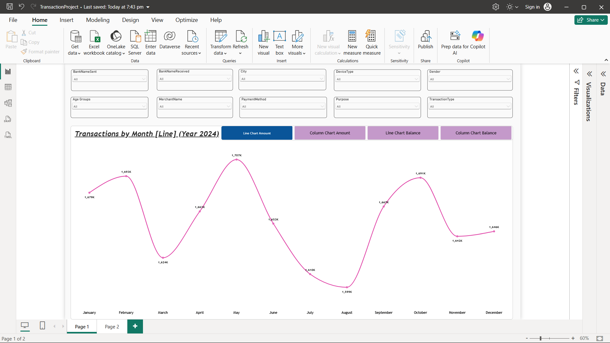
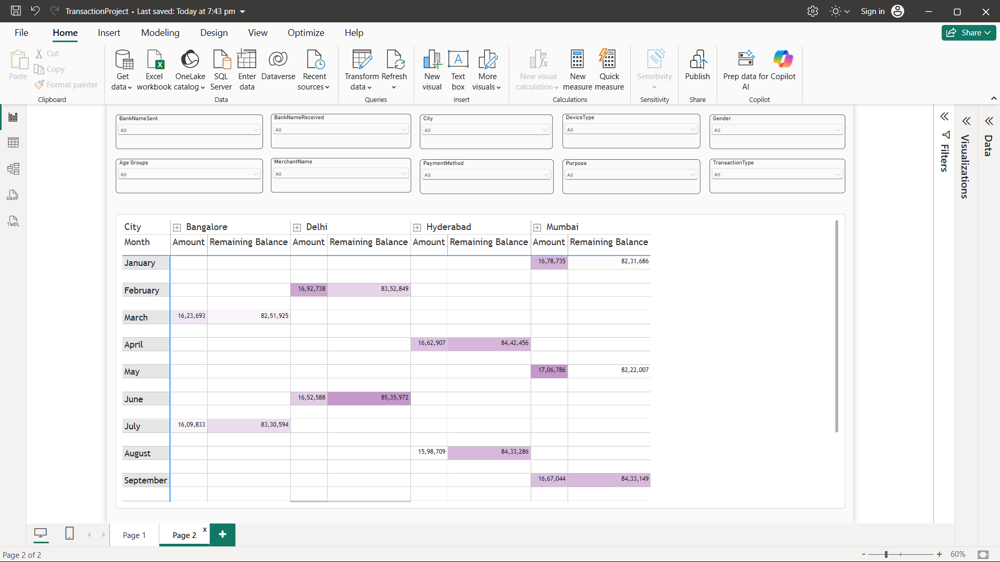

# 💸 UPI Transactions Analysis Dashboard (Excel + Power BI)

An interactive **Power BI dashboard** built on a **20,000-row UPI transaction dataset (Excel)** that tracks how transaction amounts and account balances move month by month across cities, banks, devices, payment methods, merchants and customer segments.


---

## 📌 Table of Contents
1. [Project Overview](#-project-overview)
2. [Business Questions Answered](#-business-questions-answered)
3. [Dataset Description](#-dataset-description)
4. [Project Workflow](#-project-workflow)
5. [Dashboard Walkthrough](#-dashboard-walkthrough)
6. [Key Insights](#-key-insights)
7. [Tools & Skills Used](#-tools--skills-used)
8. [Repository Structure](#-repository-structure)
9. [Future Improvements](#-future-improvements)
    

---

## 🎯 Project Overview

UPI (Unified Payments Interface) is India's most widely used real-time payment system. In this project I took a raw UPI transaction file in **Excel**, loaded it into **Power BI**, built a reporting layer on top of it, and designed a **2-page interactive dashboard** so that anyone can slice the data and see:

- how much money moved each month, and
- how the remaining account balance changed over the year,

for any combination of bank, city, gender, age group, device, payment method, merchant, purpose and transaction type.

**Data flow:**

```
UPITransactions.xlsx  ──►  Power BI (Load / Transform)  ──►  Data Model & Age Groups  ──►  Interactive Dashboard (2 pages)
```

---

## ❓ Business Questions Answered

- What is the **total transaction amount per month** in 2024? Which month is the highest and the lowest?
- How does the **remaining account balance** change month to month?
- Which **city** drives the transactions in each month?
- How do results change by **bank (sender / receiver)**, **gender**, **age group**, **device**, **payment method**, **merchant**, **purpose** and **transaction type**?

---

## 🗂️ Dataset Description

| Item | Detail |
|---|---|
| File | `UPITransactions.xlsx` (Sheet1) |
| Rows | 20,000 transactions |
| Columns | 20 |
| Period | 01 Jan 2024 – 30 Dec 2024 |
| Missing values | 0 |
| Duplicate Transaction IDs | 0 |
| Total transaction value | ≈ 1.99 crore (19,872,274) |
| Amount range | 0.05 – 1,999.87 (average ≈ 994) |
| Customer age | 20 – 59 years |

### Columns

| Column | Description |
|---|---|
| `TransactionID` | Unique ID of each transaction (TXN00001 …) |
| `TransactionDate` / `TransactionTime` | When the transaction happened |
| `Amount` | Transaction amount |
| `RemainingBalance` | Account balance left after the transaction |
| `BankNameSent` / `BankNameReceived` | Sender bank / receiver bank (SBI, HDFC, ICICI, Axis) |
| `City` | Bangalore, Delhi, Hyderabad, Mumbai |
| `Gender` | Male / Female |
| `CustomerAge` | Age of the customer (used to create **Age Groups**) |
| `TransactionType` | Transfer / Payment |
| `Status` | Success / Failed |
| `DeviceType` | Mobile / Laptop / Tablet |
| `PaymentMethod` | UPI ID / QR Code / Phone Number |
| `MerchantName` | Amazon, Flipkart, Zomato, Swiggy, IRCTC |
| `Purpose` | Food, Travel, Shopping, Bill Payment, Others |
| `PaymentMode` | Instant / Scheduled |
| `Currency` | INR, USD, EUR, GBP |
| `CustomerAccountNumber` / `MerchantAccountNumber` | Account identifiers |

---

## 🔄 Project Workflow

1. **Data collection** – UPI transaction data stored in an Excel workbook.
2. **Data checking** – verified data types, null values and duplicate IDs (none found).
3. **Load into Power BI** – connected the Excel file with *Get data → Excel workbook*.
4. **Data modelling** – used `TransactionDate` hierarchy (Year → Quarter → Month → Day) for time analysis.
5. **Feature engineering** – created an **Age Groups** column from `CustomerAge` for customer segmentation.
6. **Visualisation** – built line charts, column charts and a matrix, all driven by `Sum of Amount` and `Sum of RemainingBalance`.
7. **Interactivity** – added 10 slicers and **bookmarks** to switch between chart views with buttons.
8. **Publish-ready layout** – consistent fonts, borders, titles and colours across both pages.

---

## 📊 Dashboard Walkthrough

### Page 1 – Monthly Trend Analysis



- **10 slicers** on top: BankNameSent, BankNameReceived, City, DeviceType, Gender, Age Groups, MerchantName, PaymentMethod, Purpose, TransactionType.
- **4 bookmark buttons** to switch the main visual without leaving the page:
  - Line Chart – Amount
  - Column Chart – Amount
  - Line Chart – Balance
  - Column Chart – Balance
- Charts show **Transactions by Month (Year 2024)** and **Balance by Month (Year 2024)** with data labels.

### Page 2 – City × Month Matrix



- A **matrix** with `City` as columns (Bangalore, Delhi, Hyderabad, Mumbai) and `Month` as rows.
- Shows **Amount** and **Remaining Balance** side by side, with **colour-scale conditional formatting** so the highest values stand out.
- Same 10 slicers, so the matrix reacts to every filter.
- Cities can be expanded/collapsed using the `+` drill icon.

---

## 🔍 Key Insights

*(Based on the 2024 dataset, with no filters applied)*

- **Highest month:** May – about **1,707K** in transaction amount.
- **Lowest month:** August – about **1,599K**.
- Monthly volume stays in a narrow band of **~1.60M – 1.71M**, with small peaks in **February, May and October** and dips in **March and August**.
- Transactions are split evenly across **4 cities, 4 banks, 5 merchants and 5 purposes**, so no single segment dominates.
- **80%** of transactions are **Successful** and **20%** are **Failed**.
- The matrix on Page 2 shows each month's activity is concentrated in one city (e.g. January → Mumbai, February → Delhi, March → Bangalore, April → Hyderabad).

> ℹ️ **Note:** The dataset has very evenly distributed categories, which suggests it is a **sample / simulated dataset** built for practice. The goal of this project is the **analysis and dashboard-building process**, not real-world financial conclusions.

---

## 🛠️ Tools & Skills Used

| Category | Details |
|---|---|
| Data source | Microsoft Excel (`.xlsx`) |
| BI tool | Microsoft Power BI Desktop |
| Skills | Data cleaning & validation, data modelling, date hierarchy, calculated columns (Age Groups), aggregation (`SUM`), slicers, bookmarks, conditional formatting, matrix & chart design, dashboard storytelling |

---

## 📁 Repository Structure

```
UPI-Transactions-Dashboard/
│
├── data/
│   └── UPITransactions.xlsx        # Raw dataset (20,000 rows)
│
├── dashboard/
│   └── TransactionProject.pbix     # Power BI report file
│
├── images/
│   ├── dashboard_page1.png         # Monthly trend page
│   └── dashboard_page2.png         # City x Month matrix page
│
└── README.md
```

---

## 🚀 Future Improvements

- Add KPI cards (Total Amount, Success Rate, Failed Transactions, Average Ticket Size).
- Add DAX measures such as Month-over-Month % change and Year-to-Date totals.
- Add visuals for Status (Success vs Failed), Merchant and Purpose.
- Use real UPI data covering multiple years for forecasting.
- Publish to Power BI Service for sharing online.

---


⭐ If you found this project useful, please star the repository!
